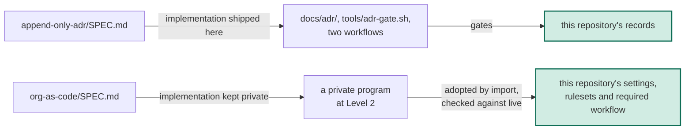

# Organizations as code is published as the second spec, and this repository demonstrates it as a governed resource

## Context

On 2026-10-16 Jacob asked for a second spec: how the company does
infrastructure as code, focused on the cases that are not normal, the
organizations. As of 2026-10-16 the private monorepo manages its
organizations as programs, and around them sits a mechanism built one
incident at a time: a coverage gate over each provider's schema, drift
compared against live, imports of what already existed, an approved-plan
apply, and a rule that a credential never becomes data. None of it was
published.

The first draft distilled all of it. On 2026-10-19 Jacob found it hard to
read, and a cold reader scored it 4 out of 10 against 8 for the first spec. It
had 23 coined terms, no example, and two ideas worth publishing buried under
practice experienced teams already know. Asked what someone else should take
away, the answer was two things: most teams do not treat their organization
as code at all, and the few who do write down only the settings someone
thought of.

The first spec's record decided that "the repository itself conforms to every
spec it publishes". A repository can run a decision log, but it cannot run an
organization, so for this spec the repository can only be one of the
resources an implementation governs.

## Decision

We will publish `org-as-code/SPEC.md`, a normative, tool-agnostic
specification built on two ideas. The organization itself is code, adopted
as it is rather than recreated. And every setting the provider offers is
either set in code or excluded with a written reason, which a gate proves,
with a scheduled check against live as the backstop. The levels are Adopted,
Decided and Bridged; the last ties a setting that trades something away to
the decision record that made the trade, as the
[append-only-adr](https://github.com/perimetercompute/specs/blob/238c400245301501a688481a8810fc2e76daaca9/append-only-adr/SPEC.md)
spec's §9 does for rules. Approvals, credentials and lockout are listed as
advice, not requirements.

This record supersedes
[`20261006-the-adr-mechanism-is-published-as-a-spec-in-a-public-specs-repository`](https://github.com/perimetercompute/specs/blob/238c400245301501a688481a8810fc2e76daaca9/docs/adr/20261006-the-adr-mechanism-is-published-as-a-spec-in-a-public-specs-repository.md)
in part. Its clause "The repository itself conforms to every spec it
publishes" is retired. In its place, each spec says in its Appendix A how this
repository demonstrates it: as a conforming implementation the repository
ships, or as a resource a conforming implementation governs. That record's
other decisions stand.

| What | Decided |
|---|---|
| The spec | `org-as-code/SPEC.md`, draft 1, about the length of the first spec |
| What it requires | adopt the organization (§4); decide every setting (§5); check it against live (§6); cite the decision behind a trade-off (§7) |
| What it only advises | a human-read plan before each apply, the credential kept out of state and unmerged code, a way back that does not depend on the program (§10.2) |
| What stays out | which tools and vendors the implementation runs on, account layout, cadences and specific values; the review tiers and agent routing of the operating playbook |
| Familiar names | Terraform and Pulumi are named together, only as examples. GitHub, which already hosts this repository in public, is the running example |
| The reference implementation | private, described by its shape in Appendix A. The program that manages its GitHub organization claims Level 2 |
| How this repository demonstrates it | as a governed resource, whose live rules anyone can read through the forge's API |
| The README | an index with a per-spec column for how this repository demonstrates it, adoption per spec, and the shape every spec shares |

### Options considered

| Option | Why it lost |
|---|---|
| Publish everything the reference implementation does (the first draft) | Two ideas worth publishing were buried under six mechanisms, four of them practice experienced teams already know. A cold reader scored it 4 out of 10 |
| A spec of all infrastructure as code | An application's database or cluster is settled practice. What most teams miss is at the organization |
| Publish the monorepo's programs and runbooks | Decision content: account layout, vendors, identities and values. It fails the test of the mechanisms record |
| Ship a generic coverage gate here as the reference implementation | Coverage is read from one tool's schema format, so the gate would bind a tool-agnostic spec to that tool. With no organization to run against, CI here would prove nothing |
| Keep the old clause and claim this repository conforms | A repository cannot conform to a spec about organizations, so the claim would be false on its face |

## Human intent

> "id' like to add a new spec for distilling how we do all our infra as code
> but i think primiarly focused on the non-normal infra as code things like
> the orgnaiztions and things like that. we may need to revise the readme and
> also id' recommend revising the readme and reviewing everyting for
> readableing and pattern adhere to our specs that already exist."

— Jacob ([@jacob-petterle](https://github.com/jacob-petterle)), pairing session (typed message; typos left as typed), 2026-10-16

> "It looks like our first spec about the Pendle and the ADR is actually
> decent. But the other one is like tricky to understand for some reason."

("the Pendle and the ADR" is the speech-to-text rendering of "the append-only
ADR", left as spoken.)

— Jacob ([@jacob-petterle](https://github.com/jacob-petterle)), pairing session (voice; speech-to-text output), 2026-10-19

> "I think the big takeaway here is most people aren't like thinking about
> their organization as infrastructure as code Maybe that's not the miss
> here. But, like, what's the most interesting thing in this spec for someone
> else to be able to take away?"

— Jacob ([@jacob-petterle](https://github.com/jacob-petterle)), pairing session (voice; speech-to-text output), 2026-10-19

> "okay, let's do a full rebuild and make sure it follows the intent of htis
> spec repo"

— Jacob ([@jacob-petterle](https://github.com/jacob-petterle)), pairing session (typed message; typos left as typed), 2026-10-19

Ratification: awaiting the decider's own words on the pull request.

## Consequences

- An adopter gets two ideas that work for any organization and any tool, and
  levels to claim, without our tools or our layout.
- Unlike the first spec, this one ships no code to copy. It is harder to
  adopt, and nothing in this repository proves it runs. The public evidence
  is this repository's own live rules.
- The Level 2 claim cannot be checked by anyone outside the company.
- Approvals, credentials and lockout are advice here, so an adopter can claim
  a level while getting them wrong. Making them requirements is a later
  spec's decision, in its own record.
- The counts in Appendix B come from the private deployment and will date.

## References

- Record-carrying PR: https://github.com/perimetercompute/specs/pull/7
- Implementing PR: https://github.com/perimetercompute/specs/pull/7
- [`20261006-the-adr-mechanism-is-published-as-a-spec-in-a-public-specs-repository`](https://github.com/perimetercompute/specs/blob/238c400245301501a688481a8810fc2e76daaca9/docs/adr/20261006-the-adr-mechanism-is-published-as-a-spec-in-a-public-specs-repository.md)
- [`20261006-mechanisms-are-published-decisions-and-the-operating-playbook-are-not`](https://github.com/perimetercompute/specs/blob/238c400245301501a688481a8810fc2e76daaca9/docs/adr/20261006-mechanisms-are-published-decisions-and-the-operating-playbook-are-not.md)
