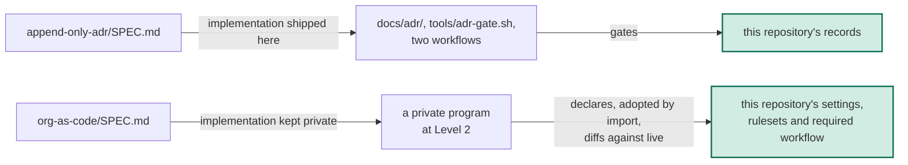

# Organizations as code is published as the second spec, and this repository demonstrates it as a governed resource

## Context

On 2026-10-16 Jacob asked for a second spec: how the company does
infrastructure as code, focused on the cases that are not normal, the
organizations. As of 2026-10-16 the private monorepo runs seven programs at
its foundation class, most of them managing one organization or account
each. Around them sits a mechanism built one incident at a time: a
registry of programs, a coverage gate over each provider's schema, drift
compared against live, a dispatch-only apply of the approved plan, and a rule
that a credential never becomes data. None of it was published.

Two facts shaped the choice. The first spec's record decided that "the
repository itself conforms to every spec it publishes". A repository can run a
decision log, but it cannot run an organization, so for this spec the
repository can only be one of the resources an implementation governs. And
the mechanism sits close to the line
[`20261006-mechanisms-are-published-decisions-and-the-operating-playbook-are-not`](https://github.com/perimetercompute/specs/blob/238c400245301501a688481a8810fc2e76daaca9/docs/adr/20261006-mechanisms-are-published-decisions-and-the-operating-playbook-are-not.md)
drew: who may approve an apply borders on who decides.

## Decision

We will publish `org-as-code/SPEC.md`, a normative, tool-agnostic
specification of how organizations, accounts and admin consoles are declared,
adopted and gated as code. It sets requirements for the registry, coverage,
drift against live, adoption and bootstrap, lockout and break-glass, the
boundary of what is managed, classes and the apply path, and credentials and
state, in three conformance levels. Its coverage, drift and credential
sections apply as SHOULD to every infrastructure program, so the spec covers
all of our infrastructure as code with the organization as the hard case.

This record supersedes
[`20261006-the-adr-mechanism-is-published-as-a-spec-in-a-public-specs-repository`](https://github.com/perimetercompute/specs/blob/238c400245301501a688481a8810fc2e76daaca9/docs/adr/20261006-the-adr-mechanism-is-published-as-a-spec-in-a-public-specs-repository.md)
in part. Its clause "The repository itself conforms to every spec it
publishes" is retired. In its place, each spec says in its Appendix A how this
repository demonstrates it: as a conforming implementation the repository
ships, or as a resource a conforming implementation governs. That record's
other decisions stand.

| What | Decided |
|---|---|
| The spec | `org-as-code/SPEC.md`, draft 1 |
| Scope | organizations, accounts and admin consoles; its coverage, drift and credential sections SHOULD apply to every program |
| What stays out | the tools and vendors the implementation runs on, account layout, cadences and specific values; who approves beyond "a human approver"; the review tiers and agent routing of the operating playbook. The forge that hosts this repository is named only where this repository is the example |
| The reference implementation | private, described by its shape in Appendix A, claiming Level 2; which Level 3 requirements it misses is not published |
| How this repository demonstrates it | as a governed resource, whose live rules anyone can read through the forge's API |
| The README | an index with a per-spec column for how this repository demonstrates it, adoption per spec, and the shape every spec shares |

### Options considered

| Option | Why it lost |
|---|---|
| A spec of all infrastructure as code | An application's database or cluster is settled practice. The mechanism worth publishing is at the organization, and the sections that apply to every program say so |
| Publish the monorepo's programs and runbooks | Decision content: account layout, vendors, identities and values. It fails the test of the mechanisms record, and it would bind the spec to one tool |
| Ship a generic coverage gate here as the reference implementation | Coverage is read from one tool's schema format, so the gate would bind a tool-agnostic spec to that tool. With no organization to run against, CI here would prove nothing |
| Keep the old clause and claim this repository conforms | A repository cannot conform to a spec about organizations, so the claim would be false on its face |

## Human intent

> "id' like to add a new spec for distilling how we do all our infra as code
> but i think primiarly focused on the non-normal infra as code things like
> the orgnaiztions and things like that. we may need to revise the readme and
> also id' recommend revising the readme and reviewing everyting for
> readableing and pattern adhere to our specs that already exist."

— Jacob ([@jacob-petterle](https://github.com/jacob-petterle)), pairing session (typed message; typos left as typed), 2026-10-16

Ratification: awaiting the decider's own words on the pull request.

## Consequences

- An adopter gets the mechanism, three levels to claim, and the shape of a
  reference implementation, without our tools or our layout.
- Unlike the first spec, this one ships no code to copy. It is harder to
  adopt, and nothing in this repository proves it runs. The public evidence
  is this repository's own live rules.
- The Level 2 claim cannot be checked by anyone outside the company, and the
  Level 3 gaps stay private, because a published list of where controls are
  incomplete is a map for an attacker. A reader has to take the claim on
  trust, which is the price of not publishing that map.
- The class model and the foundation apply sit close to the playbook line.
  The spec stops at "a human approver", and a later spec that needs more
  decides it in its own record.
- The counts in Appendix B come from the private deployment and will date.

## References

- Record-carrying PR: https://github.com/perimetercompute/specs/pull/7
- Implementing PR: https://github.com/perimetercompute/specs/pull/7
- [`20261006-the-adr-mechanism-is-published-as-a-spec-in-a-public-specs-repository`](https://github.com/perimetercompute/specs/blob/238c400245301501a688481a8810fc2e76daaca9/docs/adr/20261006-the-adr-mechanism-is-published-as-a-spec-in-a-public-specs-repository.md)
- [`20261006-mechanisms-are-published-decisions-and-the-operating-playbook-are-not`](https://github.com/perimetercompute/specs/blob/238c400245301501a688481a8810fc2e76daaca9/docs/adr/20261006-mechanisms-are-published-decisions-and-the-operating-playbook-are-not.md)
