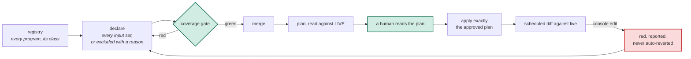

# Organizations as code

**A specification for declaring, adopting and gating the organizations,
accounts and admin consoles that everything else runs inside.**

| | |
|---|---|
| Status | draft 1 |
| Applies to | every program that manages an organization (§2); for any other infrastructure program, every requirement in §5, §6 and §9 is a SHOULD |
| Conformance keywords | MUST, MUST NOT, SHOULD, SHOULD NOT, MAY, as in RFC 2119 |
| Reference implementation | private; this repository is one of the resources it governs (non-normative, Appendix A) |

## 1. The problem

Infrastructure as code is a settled shape for an application's database or a
cluster. A program declares it, a pipeline creates it, a second copy rehearses
every change, and a mistake costs one application.

The organizations everything runs inside break each of those assumptions: the
source-control organization, the cloud organization and its accounts, the
identity provider, the DNS account, the observability and SaaS workspaces.
They were made by hand before any program existed. There is usually one of
each, so nothing rehearses a change. Each carries hundreds of settings a
vendor defaulted, and an admin can change any of them in a console. They host
the repository, the pipeline and the credential that manage them. And that
credential is the most powerful one the company holds.

| Ordinary infrastructure assumes | An organization instead | So this specification requires |
|---|---|---|
| the program created it | it existed first, made by hand | adoption, never creation (§7.1) |
| a second copy to rehearse in | it is a singleton; the plan is the only rehearsal | a human reads the plan, and the apply runs exactly that plan (§8.2) |
| the defaults are fine | hundreds of vendor defaults, and an undeclared setting is invisible to every diff | every input declared or excluded with a reason (§5) |
| the program is the only writer | admins edit it in a console, and the tool's cached state never sees the edit | every diff reads live (§6) |
| the pipeline sits outside what it manages | it hosts the repository, pipeline and credential that manage it | lockout analysis and a way back that does not depend on the program (§7.5, §7.6) |
| its credential is ordinary | its credential can rewrite identity and access for everything | the credential is never data, and unmerged code cannot reach it (§9) |

## 2. Terms

| Term | Meaning |
|---|---|
| **Organization** | a tenant-level administrative surface that holds identity, access, policy or billing for other resources: a source-control organization, a cloud organization or account, an identity provider, a DNS account, an observability or SaaS workspace |
| **Program** | the code that declares one organization's desired state, with its own recorded state and its own apply lane; a "stack" or "workspace" in some tools |
| **Plan** | the tool's computed list of the resources an apply would create, update, replace or delete, and how; distinct from a vendor's **paid plan** |
| **Default branch** | the branch a merge lands on; code that has not merged there is **unmerged code** |
| **Gate** | any check that rejects a change, plan or apply violating this specification |
| **Lane** | one automated pipeline path that plans, diffs, applies or scans a program; the **apply lane** is the one that applies it |
| **Provider** | the plug-in through which a program reads and writes an organization's API |
| **Input** | one settable field of one resource type in a provider's schema |
| **Schema extract** | a vendored, version-pinned list of every resource type and input a provider exposes |
| **Exclusion** | an input that a program deliberately does not manage, recorded with its reason |
| **Waiver** | a whole resource type that a program deliberately does not manage, recorded with a cause (§5.3) |
| **Coverage set** | for one provider, the schema extract, the declared inputs, the exclusions and the waivers, and the gate that checks them |
| **Live state** | what the organization's API returns now |
| **Recorded state** | what the tool last wrote down about the organization; a cache, never the truth |
| **Drift** | any difference between what a program declares and live state |
| **Adoption** | taking an existing resource under a program without recreating it |
| **Class** | `app`, `shared` or `foundation`: who owns a program and how far a mistake reaches (§8.1) |
| **Organization credential** | a credential that can administer an organization as a whole: its members, accounts or administrators, or who may administer it |
| **Workload credential** | a credential scoped to the resources of one environment or one application, which cannot change who administers the organization |
| **Break-glass** | the path that restores control when the apply lane is locked out |
| **Registry** | the one list of every program, with its class and drift contract |
| **Drift contract** | how a program's drift is checked: the environments diffed against live, and which live assertions run, and where |
| **Live assertion** | a check, run by the program, of a fact the organization reports but no input sets |

## 3. Principles

The requirements in §4 to §9 follow from six principles. Where a requirement
is silent, the principles decide.

1. **Live is the truth; recorded state is a cache.** A diff against the cache
   cannot see a console edit, or a write the provider accepted and ignored.
2. **Every setting is a decision.** A vendor default nobody chose is an
   accident, and an input the program never declares is invisible to every
   diff.
3. **The organization was there first.** A program adopts it. A program never
   owns whether the organization exists.
4. **A singleton has no rehearsal.** The plan is the rehearsal, so the plan a
   human read is the plan that runs.
5. **A program must not lock out its own apply lane,** and the way back must
   not depend on the program.
6. **A credential is never data.** A value a program records is a value every
   reader of its state can read.

## 4. The registry

1. An implementation MUST keep one registry of every program. An entry MUST
   carry the program's class (§8.1), its environments, its credentials, and
   its drift contract (§6). Each field MUST be set explicitly; a defaulted
   field lets an omission decide. The providers a program manages MAY be
   derived from the program's declared dependencies rather than repeated.
2. The lanes that plan, diff, apply and scan a program, and the program's
   access to its recorded state, SHOULD be generated from the registry, so
   that registering a program is what enrolls it everywhere.
3. A gate MUST fail a program that is not registered. A gate MUST fail a
   registered program that lacks a coverage set for any provider it manages
   (§5), and an applied program that lacks a scheduled drift check (§6.3).
4. The registry SHOULD also list every organization the company holds that no
   program manages, each with its reason (no provider exists; the organization
   is being retired). An inventory that starts from the programs cannot show
   what has none.

## 5. Declaration and coverage

### 5.1 Declaration

Every managed input MUST be declared as a typed value in the program. A value
that departs from the provider's default, or whose reason is not obvious,
SHOULD carry its reason beside it, where the next reader of the value sees it.

A value an organization passes down to its members by default (to new
accounts, new repositories, new workspaces) SHOULD also be declared on each
member the program manages. Inheritance is a default, not a declaration: it
changes when the parent setting or the vendor's behavior does, and no diff of
the member shows it.

### 5.2 The schema extract

A program MUST vendor a schema extract for each provider it manages,
generated by a script from the provider's published schema and stamped with
the provider version. A gate MUST fail when the provider version changes and
the extract was not regenerated. The extract is a lockfile, not a second
source of truth: nobody edits it by hand.

### 5.3 Coverage

For every resource type in scope (§5.4), a gate MUST prove that each input is
either declared by the program or listed as an exclusion with a reason.

1. Every resource type in scope MUST be either managed or waived as a whole. A
   waiver MUST carry a cause from a closed set (below). A cause that claims
   the API refused or a paid plan gates SHOULD quote the API's own response.
2. An input or type the extract holds and the program neither declares nor
   excludes is unaccounted, and an unaccounted input MUST fail the gate. A
   provider upgrade that adds an input therefore fails until someone decides
   it.
3. A type the program builds but does not declare, or declares but never
   builds, MUST fail the gate. A waived type MUST NOT be built.
4. A gate SHOULD pin the count of waivers, so that a new one is a visible
   change rather than a quiet addition.

A waiver is a decision to declare nothing, which has no diff to review. The
list is the only thing separating "reviewed and rejected" from "never
considered", so each cause names what would lift it.

| Cause | Lifts when |
|---|---|
| the API refuses the write | the program's identity is granted more |
| a paid plan gates it | the paid plan is bought |
| a provider defect | the provider ships a fix |
| not applicable | the decision that made it so is revisited |
| no settable inputs | never; there is nothing to declare |

### 5.4 Scope and stated limits

Coverage SHOULD span the provider's whole surface where it is small enough to
audit. Where it is not, the program MUST write its scope down where the gate
reads it: the types that carry identity, access, audit or policy under full
coverage, and every other type it builds under drift detection only. The
coverage file SHOULD also state its scope and its limits in its own text,
because a gate's scope is invisible from outside it. A common limit is that
coverage reaches top-level inputs only, so a nested default inside a declared
structure is a decision of the code that builds it, never something the gate
proved.

### 5.5 Review before the first declaration

When a program first takes over an organization, each input in scope SHOULD
be reviewed one by one before it is declared: a recommended value, the reason,
the risk, and a human's chosen value and note. The note becomes the reason of
§5.1. A separate read-only check SHOULD verify the recommendations against
the provider's real behavior and plan gating, because drafted recommendations
carry plausible errors.

### 5.6 Collections are complete

A declared collection whose members grant access (members, teams,
administrators, installed applications, accounts, repositories) SHOULD be
complete: a census SHOULD compare the live members against the program and
report each one the program does not declare. Drift detection alone cannot
see a resource the program never declared.

## 6. Drift against live

1. Every diff MUST read live state before it compares: every plan, the
   scheduled drift check, and the apply. An apply against recorded state
   cannot revert a live-only change, and reports success having done nothing.
2. The read MUST go through the provider configuration the program declares
   now, never the one in recorded state. Otherwise a rotated credential is
   never used, and a stale but valid one reads live as the wrong identity and
   reports no drift.
3. Every program MUST be diffed against live on a schedule. Drift MUST turn
   the check red and be reported. A run that cannot reach a verdict MUST
   report itself inconclusive, never green. The check MUST NOT revert on its
   own: the edit may be a break-glass fix (§7.6).
4. Drift is resolved by a change that adopts the live value into code, or by a
   reviewed apply through the program's own lane that restores it. Recorded
   state MUST NOT be edited by hand to hide drift. To resolve drift, the one
   hand edit allowed removes a resource that no longer exists live, whose
   failed read blocks every lane; it SHOULD follow the merge of the change
   that removes the resource's declaration, because an apply in between
   recreates it.
5. A drift report SHOULD be one standing item that escalates rather than
   repeats, and SHOULD notify again only when the drift changes. Recording the
   revision last applied lets the report tell code ahead of live (an apply is
   pending) from live moved away from code (drift).
6. An instruction to ignore changes on an input MUST carry its reason, and
   MUST NOT be relied on as a control: it suppresses the diff, not the read.
   Where it covers a field the vendor changes on its own, it SHOULD carry the
   date by which a human re-inspects it (§8.4).
7. A fact the organization reports but no input sets (that every member has a
   second factor; that a public repository accepts vulnerability reports)
   SHOULD be a live assertion, failing closed in the plan, the apply and the
   drift check alike. Each organization SHOULD prove its own baseline this
   way; a baseline "covered by another account" is not proven for this one.
8. A write to the organization's identity federation or access policy that
   does not come from the apply lane SHOULD alert when it happens, not at the
   next scheduled diff.

## 7. Adoption, bootstrap and the boundary

### 7.1 Adoption

A resource that exists live MUST be adopted, never recreated. The adoption
SHOULD ride the program as a declared import that is a no-op once recorded
state holds the resource, and a test SHOULD pin the imported identifiers.
An adopted resource's inputs that only take effect at creation MUST be
excluded with that reason.

### 7.2 Resources born by hand

Where a resource is born by hand (a new repository, a new account), because
only a human may create it or because the program deliberately does not
create that kind of resource, the human creates it, and the next change MUST
declare and adopt it. A resource created by hand and never
declared is ungoverned, and §5.6 is how it is found.

### 7.3 Vendor residue

A program declares what should exist, so it cannot declare that something
must not. Residue a vendor creates by default and the organization does not
want (a default network, a default role, a sample project) SHOULD be removed
once, by a reviewed sweep that reads live, and then forbidden by a live
assertion (§6.7) so that it cannot return unseen.

### 7.4 Bootstrap

The hand steps that precede a program's first apply (the organization, the
program's own identity and its key, the state backend, the key that encrypts
recorded state) MUST be written down before they run. A resource created by
hand during bootstrap SHOULD be created with exactly the settings the program
declares, then adopted like any other.

An import does not fail on a mismatch: it records whatever live holds. The
plan after the import is therefore the only check that live matches code,
and the first apply MUST be preceded by one, read against live, with no
delete, no replace, and no change outside the categories the runbook names.
Anything else aborts. Until the first apply, recorded state is disposable.

A first apply SHOULD be staged, with the resources that change who may merge
or deploy applied last. A runbook's list of resources to import SHOULD be
derived from the program and tested, so the two cannot disagree.

### 7.5 Lockout

A program MUST NOT apply a change that can block its own apply lane, or the
change path into its own repository, without a reviewed way back. These
shapes recur:

| Shape | Why it locks out |
|---|---|
| requiring a status check that has never reported on that path | every change waits forever on a context that never arrives |
| requiring an approval nobody can give | one maintainer cannot approve their own change |
| a rule that blocks the program's own identity | the next apply cannot undo the rule |
| the program manages the approval gate its own apply waits on | a bad plan can remove the human who would have stopped it |
| a deny policy that also binds the recovery identity | the path back is closed by the change it was meant to undo |
| a key policy that drops the account's own recovery access | recorded state, and everything it encrypts, becomes unreadable |

A guardrail that denies SHOULD be applied only after the recovery path is
proven to work live, first to one unit of the organization, probed, and then
widened. A gate SHOULD assert, for every required check, that something
reports it on every path to the default branch, a merge queue included.

### 7.6 Break-glass

A break-glass path MUST exist that does not depend on the program: an identity
and a written procedure that can disable the offending control directly. The
break-glass identity MUST NOT depend on an identity provider the program
manages, SHOULD require a hardware second factor, SHOULD be guarded against
deletion by plan (§8.3), and every use of it SHOULD alert. The path SHOULD be
drilled on a schedule, with each drill declared in advance so it is recorded
rather than paged. After break-glass, the next reviewed apply reconciles the
organization to code, and the drift check of §6.3 reports the gap until it
does.

### 7.7 The boundary

A program manages an organization's settings and policy. It never manages the
content the organization holds: files in a repository, issues, tickets,
messages. A program MUST keep a written list of what it deliberately does not
manage, each with its reason. Four reasons recur:

| Reason | Example shape |
|---|---|
| content changes in the ordinary course of work, so a diff carries no signal | issues, labels, releases, pull requests |
| a person owns it, not the organization | a user's keys, the acceptance of an invitation |
| the program's identity cannot reach it by construction | an endpoint served only to a user token |
| managing it would create a second place deciding the same policy | a per-repository override of an organization-wide policy |

An item with a security bearing that the program cannot reach SHOULD have a
read-only verification, so the boundary is checked even where it is not
declared.

## 8. Classes and the apply path

### 8.1 Classes

Every program MUST carry exactly one class, decided by who owns it and how
far a mistake reaches.

| Class | What belongs | Its apply |
|---|---|---|
| `app` | what one application owns | with that application's deploy |
| `shared` | what several applications share, recoverable, reachable with a workload credential, with a real second instance to rehearse in | automatically to the rehearsal instance; to production after an approval |
| `foundation` | an organization-wide trust, identity or audit boundary; a one-way door; anything that needs an organization credential | only as §8.2 |

1. When two classes fit, the credential the apply needs decides. A program
   that needs an organization credential is `foundation`, however routine it
   feels.
2. A class belongs to the program, never to an environment.
3. An organization program is `foundation` unless a real second instance
   exists to rehearse it in. Rehearsability never buys an automatically
   applied lane an organization credential.
4. Where an organization exists once per environment, every environment's
   program SHOULD get the same lanes, gates and live assertions. Environments
   differ only in values; a gate that exists in one environment and not the
   other is a gap that the cheaper environment hides.

### 8.2 The foundation apply

A `foundation` program:

1. MUST NOT apply on merge. It MUST apply only by an explicit dispatch from
   the default branch.
2. MUST produce its plan in that dispatch, read against live (§6), and MUST
   show it to a human approver before applying. The approval MUST be a control
   the forge or pipeline enforces, never a written instruction, and an
   administrator MUST NOT be able to skip it.
3. MUST apply from the revision that produced the approved plan. A gate MUST
   compare the resources and operations about to apply against the approved
   plan and refuse any difference. Applying the saved plan itself is stricter,
   and SHOULD be preferred where the tool supports it.
4. MUST NOT plan from unmerged code, because the plan runs with the
   organization credential (§9.4).
5. SHOULD judge the plan against a list of absolute actions that no approval
   admits (closing an account, disabling an audit trail), and that judgement
   MUST fail closed when it cannot read the plan.

A `shared` or `app` program SHOULD show its plan, read against live, on every
change that touches it.

### 8.3 Destructive changes

A resource whose deletion cannot be undone (an account, a repository, a
membership, a domain) MUST be guarded against deletion by plan: by the
provider's archive or retain-on-delete behavior, by deletion protection, or by
the tool's protection flag. Protection refuses a planned delete; it does not
stop a diff that reads live from finding the resource already gone. Removing
a resource from a program is a delete, so recorded state SHOULD be checked
for what the plan will delete before the declaration is removed. A test
SHOULD pin every resource's logical name, because renaming one plans a delete
and a create.

### 8.4 Concessions with a trigger

A setting held below its intended value for a reason SHOULD carry, beside the
value, the trigger that reopens it. A date trigger SHOULD fail the build on
its date, so a temporary concession cannot become permanent by being
forgotten.

## 9. Credentials and state

1. **A credential is never an input.** A tool records every input of every
   resource, so a value reaches recorded state if and only if it is an input.
   A credential MUST NOT be carried by any resource input, or by any provider
   configuration field the provider's schema marks secret. A credential the
   plug-in reads from its own process environment is an input to nothing and
   never lands. An input whose live value is itself the secret MUST be
   declared write-only, and that declaration applied before the first real
   value is written. A credential nothing needs to read back SHOULD be minted
   outside the program, straight into the secrets store. A resource whose
   secret would enter recorded state SHOULD be referenced by identifier rather
   than managed, with its settings checked by a live assertion (§6.7).
2. **An exception is bounded.** Where a provider makes §9.1 impossible, the
   exception MUST be stated in full beside the code, MUST be bounded by a test
   that fails if it widens, and the exposed credential MUST be treated as
   compromised when it rotates.
3. **The rule MUST be enforced in three layers,** because each is blind to
   what the others see: a hermetic scan of the program, taking the
   secret-field list from the installed provider so an upgrade arms it with no
   human step; a registry check that no program skips the scan; and a
   credentialed scan of what recorded state actually holds, reporting paths
   and fingerprints, never values.
4. **Credentials are separated by class.** A lane that applies automatically
   MUST NOT hold an organization credential, and a lane that plans a change
   holds the weakest credential of all. Unmerged code MUST NOT reach an
   organization credential without passing the human approval of §8.2. An
   approval environment is not a branch gate unless proven to be one, so the
   credential's trust condition SHOULD name the default branch, and every lane
   that enters the approval environment SHOULD refuse to run for a change. The
   drift check SHOULD read live with a read-only credential. The organization
   credential SHOULD be an identity the organization owns rather than a
   person's token, read at apply time from a secrets store by a role that can
   read nothing else. A lane MUST NOT be able to mint a credential stronger
   than one it may hold. A credential SHOULD exist once per consumer,
   environment and organization, and be named for its consumer, so a leak
   names its source and a rotation touches one lane.
5. **A lane that runs a change's code reads only what it plans.** Recorded
   state holds every input, and a plan lane runs code nobody has reviewed yet.
   Such a lane MUST be able to read only the recorded state of the programs
   registered for it to plan, including any registered ahead of their first
   plan, and a test MUST assert that grant in both directions: a missing grant
   is loud and harmless, an extra one is silent and is the leak. Encryption is
   not access control when the reader holds the key. Every other lane SHOULD
   read only its own program's state.
6. **Rotation proves before it retires.** A rotation SHOULD verify the new
   value by a read-back fingerprint, never by printing it, and SHOULD retire
   the old value only once the new one is seen in use and the old one has gone
   quiet.

## 10. Enforcement

A conforming implementation MUST reject each of the following.

| Property | The gate rejects |
|---|---|
| Registry (§4) | an unregistered program; a registered program with no coverage set for a provider it manages; an applied program with no drift check |
| Extract (§5.2) | a provider version change without a regenerated extract |
| Coverage (§5.3) | an unaccounted input or type; a type built but not declared, or declared but not built; a built waived type; a waiver with no cause |
| Drift (§6) | a diff, drift check or apply that does not read live through the declared configuration; drift, on the schedule; an inconclusive run reported green |
| Foundation apply (§8.2) | an apply on merge; an apply not dispatched from the default branch; an apply whose revision, resources or operations differ from the approved plan; a plan judgement that cannot read the plan |
| Credentials (§9) | a credential in a resource input or a secret provider field; an exception that widened; a program that skips the scan; a plan lane granted state it is not registered to plan |

A gate MUST assert only what the program and the organization's API report.
Every failure message SHOULD name the fix.

## 11. Conformance levels

| Level | Name | Requires |
|---|---|---|
| 1 | **Declared** | §4.1, §5.1, §7.1, §7.2, §7.4 and §8.1: every organization a program manages is registered, adopted rather than created, and applied only by its lane |
| 2 | **Proven** | Level 1, plus §4.3, §5.2 to §5.4, §6.1 to §6.4, §8.2 and §9.1 to §9.5: coverage is a gate, every diff reads live, a foundation apply runs only the approved plan's resources and operations, and no credential is data or reachable from unmerged code without approval |
| 3 | **Sealed** | Level 2, plus §4.4, §5.6, §6.5 to §6.8, §7.3, §7.5 to §7.7, §8.3 and §8.4: every organization is accounted for, collections are complete, every organization proves its baseline live, lockout is analysed, break-glass is written, the boundary is listed, and deletion is guarded |

A level requires every MUST in the sections and items it lists. Where a listed
item holds only SHOULDs, the level makes them requirements. An implementation
claiming a level SHOULD say so beside its registry and name any requirement
of the next level it does not yet meet.

## 12. Operational considerations

### 12.1 Provider upgrades

An upgrade regenerates the extract, and every new input fails coverage until
someone declares or excludes it. The upgrade is therefore a review of the new
settings, never a version bump alone.

### 12.2 A write the provider accepts and ignores

Some APIs return success and keep the old value, or write back a concrete
value for an input the program excluded. Only a diff that reads live shows
either; recorded state shows the value the program sent.

### 12.3 Settings a paid plan gates

A setting the organization's paid plan does not include is waived or
excluded with that cause. Changing paid plans reopens every such entry as a
decision; it does not apply the vendor's default for the new paid plan by
itself.

### 12.4 Moving a resource between programs

Moving a resource from one program or provider instance to another is a move
in recorded state, reviewed like an apply. It is never a delete in one
program and a create in the other: for a singleton, that delete is the
outage.

### 12.5 People joining and leaving

Membership is declared, so removing a person from code removes them from the
organization. A provider option that downgrades rather than removes a member
on delete keeps access that no declaration explains, and SHOULD be off.

## Appendix A (non-normative): the reference implementation

The reference implementation is a private repository. It manages each of
its organizations as a registered program, most at the `foundation` class; an
organization with a full second instance to rehearse in applies as `shared`
(§8.1). Its shape:

| Part | Implements |
|---|---|
| the registry, with each program's class, environments and drift contract, and a test enrolling every program | §4 |
| a function per area returning typed inputs, with the reason at each value | §5.1 |
| a regeneration script and a vendored, version-stamped extract per provider | §5.2 |
| a coverage file per provider: declared inputs, exclusions with reasons, waivers with typed causes, and the scope | §5.3, §5.4 |
| a scheduled drift lane that reads live through the declared configuration and keeps one standing report | §6 |
| live assertions the program runs in plan, apply and drift | §6.7 |
| runbooks: bootstrap, adding a resource born by hand, break-glass, what a program does not manage | §7 |
| a dispatch-only apply lane with a required approval, a judgement of the plan against absolute actions, and a guard comparing the apply's resources and operations to the approved plan | §8.2 |
| a hermetic secret-field scan, its registration check, a credentialed scan of recorded state, and a test of the plan lane's state grant in both directions | §9 |

This repository is one of the resources it governs. An organization owner
created the repository by hand; the next change declared it and adopted it by
import (§7.2). Its settings, its rulesets and the required workflow of the
[append-only-adr](../append-only-adr/SPEC.md) spec's reference
implementation are declared there, and the drift lane reports a console edit
to any of them. The live result is public on the forge's API:
`GET /repos/perimetercompute/specs/rules/branches/main`.

The implementation claims Level 2. It does not meet Level 3, and does not
publish which requirements it misses: a published list of where an
organization's controls are incomplete is a map for an attacker.

## Appendix B (non-normative): one deployment

One company, agents writing most of the code, the source-control organization
under a program since 2026-07-23. Counts as of 2026-10-16.

| | |
|---|---|
| Programs at the `foundation` class | 7 |
| Records in the decision log that decide part of this mechanism, classified by reading each record's Decision | 51 |
| Of those, superseded in whole or in part by a later record | 18 |
| Resource types in the source-control provider's extract | 88 |
| Of those, waived as a whole, each with a typed cause | 71 |

## Appendix C (non-normative): relation to existing practice

| | plan-and-apply infrastructure as code, as usually run | a settings-sync application | a posture scanner | this specification |
|---|---|---|---|---|
| What it covers | the inputs someone thought to declare | the settings its file format names | the benchmark's checks | every input of the provider's schema, declared or excluded with a reason |
| Drift | against recorded state, when a plan happens to run | reverted on the next event | reported against the benchmark, not against code | against live, on a schedule, reported and never auto-reverted |
| Who creates the organization | often the program | a human | a human | a human; the program adopts it |
| Review of a change to the organization | the plan, if someone reads it | the file change | none | a plan read against live, approved by a human, and applied exactly |
| The organization credential | often in the pipeline's environment, sometimes in state | held by the application | read-only | never in state, and unreachable from unmerged code without approval |

None of those is wrong for what it was built to do. The difference is the
organization: a singleton that existed before the code, edited in a console,
hosting the pipeline that manages it, with the most powerful credential the
company holds.
