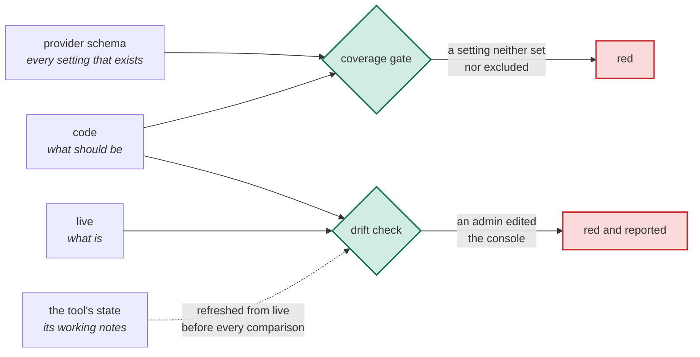

# Organizations as code

**A specification for managing an organization's settings as code: adopted rather than recreated, every setting decided, and checked against what is live.**

| | |
|---|---|
| Status | draft 1 |
| Applies to | the settings of an organization: a GitHub organization, a cloud organization or account, an identity provider, a SaaS admin console |
| Tools | any declarative infrastructure tool. Terraform and Pulumi are named only to illustrate |
| Examples | a paragraph marked *Example.* is non-normative |
| Conformance keywords | MUST, MUST NOT, SHOULD, SHOULD NOT, MAY, as in RFC 2119 |
| Reference implementation | private; this repository is one of the resources it governs (non-normative, Appendix A) |

## 1. The problem

Most teams write their applications' infrastructure as code and manage the
organization around it by hand. The GitHub organization, the cloud
organization, the identity provider and the SaaS admin consoles decide who
can do what for everything else, and their settings live in web consoles.

Teams that do bring an organization under code usually write down the
settings someone thought of. A GitHub organization has a couple of hundred.
The rest stay at whatever the vendor chose, a decision nobody made. No plan
shows them, so when an admin changes one in the console, or the vendor
changes a default, nothing notices.

This is the failure the [append-only-adr](../append-only-adr/SPEC.md) spec
names for decisions: an unrecorded "no" is indistinguishable from never having
considered it. This specification asks for three things.

| | What it asks | Section |
|---|---|---|
| **Adopt** | bring the organization under code as it is, without recreating it | §4 |
| **Decide** | set every setting in code, or exclude it with a written reason, and let a gate prove nothing was skipped | §5 |
| **Watch** | compare code with the organization as it is live, on a schedule | §6 |

## 2. Terms

| Term | Meaning |
|---|---|
| **Organization** | an account that holds identity, access, policy or billing for other things: a GitHub organization, a cloud organization or account, an identity provider, a DNS account, a SaaS workspace |
| **Program** | the code that manages one organization: a Terraform root module, a Pulumi project |
| **Provider** | the plug-in through which the tool reads and writes an organization's API |
| **Setting** | one field a provider lets you set on one resource type, such as a GitHub organization's `default_repository_permission` |
| **Schema** | the provider's own list of every resource type and setting it supports |
| **Live** | what the organization's API returns right now |
| **State** | the tool's working notes from its last run: Terraform's state file, Pulumi's checkpoint. A plan compares code with state, so state is safe to compare against only right after it is refreshed from live |
| **Drift** | code and live disagree |
| **Exclusion** | a setting the program deliberately leaves alone, written down with its reason |
| **Managed type** | a resource type the code creates; every one of its settings is set or excluded |
| **Skipped type** | a resource type the code never creates, written down with its cause |
| **Out of scope** | for a provider too large to cover whole, a type outside the coverage gate's list, watched only against live (§5.5) |
| **Gate** | a check this specification requires, run on a change or on a schedule |
| **Coverage gate** | the check that every setting in the schema is either set in code or excluded |

## 3. Principles

The requirements in §4 to §8 follow from four principles. Where a requirement
is silent, the principles decide.

1. **Code says what should be. Live says what is. State is the tool's working
   notes.** Code is the source of truth. State is safe to compare against only
   right after it is refreshed from live, and is never edited to change
   either.
2. **Every setting is a decision.** A default nobody chose is a decision
   nobody made.
3. **A "no" is written down.** An excluded setting carries its reason, or it
   is indistinguishable from one nobody considered.
4. **The organization came first.** Code adopts it, and never decides whether
   it exists.

## 4. Adopt the organization

**Bring the organization under code as it is. Never recreate it.**

*Example.* The GitHub organization has existed for years. The program
imports it and its repositories, with Terraform `import` blocks or Pulumi's
`import` option. The first plan, read against live, shows the imports and
nothing else. Later, someone creates a repository in the web console, and the
next pull request declares and imports it.

1. A resource that already exists MUST be adopted into the program, never
   recreated. Its settings that only take effect at creation MUST be excluded
   with that reason. The adoption SHOULD be an import written in code, which
   does nothing once state holds the resource.
2. A resource created by hand MUST be declared and adopted by the next change
   to the program, or recorded, with its reason, as deliberately left outside
   it.
3. The hand steps before a program's first apply MUST be written down before
   anyone runs them. An import accepts whatever is live without checking it
   against the code. So the first apply MUST follow a plan, read against live,
   that shows no deletes, no replacements, and no change except those the
   written steps name.
4. Every program that manages an organization MUST be on a list the gates
   read. A program missing from the list MUST fail CI.

## 5. Decide every setting

**Every setting the provider offers is either set in code or excluded with a
written reason, and a gate proves it.**

*Example.* A script saves the GitHub provider's schema, with
`terraform providers schema -json` or `pulumi package get-schema`. The code
sets `default_repository_permission`, with a comment saying why. It excludes
`location` as "profile text, not policy". A provider upgrade adds a setting,
and CI fails until someone sets it or excludes it.

1. The program MUST keep a copy of the provider's schema, generated by a
   script and stamped with the provider version. The gate MUST fail when the
   provider version changes and the copy was not regenerated. Nobody edits
   the copy by hand.
2. Every setting the program manages MUST be set in code as a typed value.
   Its reason SHOULD sit beside it, where the next reader of the value sees
   it.
3. For every resource type in scope, the gate MUST fail on any setting that
   is neither set in code nor excluded with a reason.
4. Every resource type in scope MUST be either managed or skipped. A skipped
   type MUST name a cause from the table below, and the code MUST NOT create
   it. The gate MUST fail if the code creates a type the program has not
   classified (managed, or out of scope under item 5), and if the managed list
   names a type the code never creates.
5. Coverage SHOULD span the provider's whole schema when it is small enough
   to review. When a provider is too large (a cloud provider can have
   thousands of types), the program MUST list the types in scope in a file
   the gate reads. That list SHOULD include every type that controls
   identity, access, audit or policy, and the rest is watched by §6 alone.
6. The coverage file SHOULD state what it does not prove, such as nested
   fields inside a setting.
7. A value the organization passes down by default (to new repositories, new
   accounts) SHOULD also be set on each one. Inheritance changes when the
   parent does, and no plan of the child shows it.
8. When a program first takes over an organization, a human SHOULD decide
   each setting one by one, from a recommended value, its reason and its
   risk. A separate read-only check SHOULD then verify the recommendations
   against how the provider really behaves, because drafted recommendations
   carry plausible errors.

| A type is skipped because | It can be revisited when |
|---|---|
| the API refuses the write | the program's identity is granted more |
| a paid plan gates it | the plan is bought |
| a provider defect | the provider ships a fix |
| it does not apply here | the reason it does not apply changes |
| it has no settable fields | never |

A cause that says the API refused or a paid plan gates SHOULD quote the API's
response. A gate SHOULD pin how many types are skipped, so a new skip is a
visible change rather than a quiet one.

## 6. Watch it against live

**A check compares code with the organization as it is live, on a schedule.
It refreshes the tool's state from live first, and it never fixes drift on
its own.**

*Example.* An admin changes `default_repository_permission` in the web
console. State still holds the old value, so a plan that skips the refresh
says "no changes"; Pulumi's plan skips it unless given `--refresh`. The
scheduled drift check re-reads live, sees the difference, and goes red.

1. Every plan, drift check and apply MUST re-read live before it compares.
2. The re-read MUST use the credentials and provider settings the code
   declares now. Some tools re-read with the ones saved in state, so a
   rotated key is never used, and an old valid key can read live as the
   wrong identity and miss drift.
3. Every applied program MUST be checked for drift on a schedule. Drift MUST
   turn the check red. A run that could not finish MUST say so, never pass.
   The check MUST NOT undo the drift itself, because the edit may be an
   emergency fix. While a merged change waits to be applied, the check MAY
   report a difference as pending, not red, for a bounded time the program
   states, and MUST turn red after it. A console edit made in that window
   waits with it.
4. Code stays the source of truth, so drift ends with code and live agreeing.
   If the console edit was right, a change brings code up to it; if not, a
   reviewed apply puts live back. State MUST NOT be hand-edited to hide drift.
   One hand edit is allowed: deleting from state a resource that no longer
   exists and whose failed read blocks every run. That deletion SHOULD follow
   the merge of the change that stops declaring the resource, because an
   apply in between recreates it.
5. An instruction to ignore changes on a setting MUST carry its reason.
   Ignoring a setting hides its drift from the check but stops nobody from
   changing it, so it is never a control.
6. Some facts can be read but not set: GitHub reports whether every member
   has two-factor authentication, but the provider offers no setting to
   require it. The program SHOULD check such facts with a read-only assertion
   that fails the plan, the apply and the drift check alike.
7. Drift cannot see what code never declared. A census SHOULD list the live
   members of every collection that grants access (members, administrators,
   installed apps, accounts, repositories) and report each one the code does
   not declare.
8. The drift report SHOULD be one standing item that escalates rather than
   repeats, and SHOULD notify again only when the drift changes.

## 7. Enforcement

A conforming implementation MUST reject each row its level requires (§9).

| Property | The gate rejects | Level |
|---|---|---|
| Adopt (§4) | a program that manages an organization but is missing from the list the gates read | 1 |
| Watch (§6) | a plan, drift check or apply that does not re-read live with the code's credentials; drift, on the schedule; an unfinished run reported as passing | 1 |
| Decide (§5) | a schema copy older than the provider; a setting in scope neither set nor excluded; a type neither managed nor skipped; a skipped type with no cause, or created by the code; a type the code creates but nobody classified; a managed type the code never creates | 2 |

A gate MUST assert only what the code and the organization's API report.
Every failure message SHOULD name the fix.

## 8. The bridge to the decision log

**A setting held at a value that trades something away cites the decision
that made the trade.**

*Example.* A ruleset lets one bot account merge without review. The line
that grants the bypass cites the decision record in which a human chose it,
and why.

1. A setting or exclusion whose value is a trade-off (an exception, a
   deferral, a value held below the one intended) SHOULD cite, beside it,
   the record that decided it, as in §9 of the
   [append-only-adr](../append-only-adr/SPEC.md) spec. A reason that only
   describes ("profile text, not policy") cites nothing.
2. A value held below the one intended SHOULD carry the trigger that reopens
   it. A date trigger SHOULD fail the build on its date, so a temporary
   concession cannot become permanent by being forgotten.

## 9. Conformance levels

| Level | Name | Requires | In short |
|---|---|---|---|
| 1 | **Adopted** | §4, §6.1 to §6.5, and §7 for them | the organization is code, adopted rather than recreated, and a console edit turns a check red |
| 2 | **Decided** | Level 1, plus §5.1 to §5.5, and §7 for them | every setting in scope is set or excluded with a reason, and a gate proves it |
| 3 | **Bridged** | Level 2, plus §8 | every trade-off in a setting cites the decision that made it |

A level requires every MUST in the items it lists. Where a listed item holds
only SHOULDs, the level makes them requirements. An implementation claiming a
level SHOULD say so beside its code.

## 10. Operational considerations

### 10.1 Changes over time

| Situation | What to do |
|---|---|
| A provider upgrade | Regenerate the schema copy. Each new setting fails the gate until someone decides it, so an upgrade is a review of new settings, never a version bump alone |
| The API accepts a write and ignores it | Only a re-read of live shows it. State shows the value you sent, not the one the vendor kept |
| A paid plan changes | Every setting excluded or skipped because of the plan is a decision again. Changing plans does not apply the new plan's defaults by itself |
| A resource moves to another program | Move it in state, and review the move like an apply. Never delete it in one program and create it in the other: for a singleton, that delete is the outage |
| A person leaves | Removing them from code removes them from the organization. A provider option that downgrades instead of removing keeps access no line of code explains, and SHOULD be off |

### 10.2 Running it safely

An organization differs from ordinary infrastructure in three more ways.
They are outside this specification's levels, but an implementation SHOULD
still meet all three.

| Because | An implementation SHOULD |
|---|---|
| there is no staging copy of an organization | have a human read the plan, against live, before every apply, and apply nothing else |
| the credential that manages it can change who administers everything | never let that credential reach the tool's state, or code that has not merged |
| it hosts the repository and pipeline that manage it | keep a way back that does not depend on the program; a ruleset that requires a check nothing has ever reported blocks the fix for itself |

## Appendix A (non-normative): the reference implementation

The reference implementation is a private repository. It manages each of its
organizations as a program, in this shape:

| Part | Implements |
|---|---|
| a list of every program, and a test that fails CI for a program the gates do not check | §4.4 |
| per provider: a script that regenerates the schema copy, the versioned copy, and a coverage file of set settings, exclusions with reasons, skipped types with causes, and the scope | §5 |
| a drift job on a schedule that re-reads live with the code's credentials, and keeps one standing report | §6 |
| read-only assertions of facts no setting controls, run in plan, apply and drift | §6.6 |

This repository is one of the resources it governs. An organization owner
created the repository by hand, and the next change declared it and imported
it (§4.2). Its settings, its rulesets, and the required workflow of the
append-only-adr reference implementation are declared there, and the drift
check reports a console edit to any of them. Anyone can read the live result
from GitHub's public API:
`GET /repos/perimetercompute/specs/rules/branches/main`.

The program that manages its GitHub organization, which governs this
repository, claims Level 2.

## Appendix B (non-normative): one deployment

One company, agents writing most of the code, its GitHub organization under a
program since 2026-07-23. Counts as of 2026-10-16.

| | |
|---|---|
| Resource types in the GitHub provider's schema | 88 |
| Of those, managed, with every setting set or excluded | 17 |
| Of those, skipped as a whole, each with a cause | 71 |

## Appendix C (non-normative): relation to existing practice

| | Infrastructure as code, as usually run | A settings-sync app | A posture scanner | This specification |
|---|---|---|---|---|
| What it covers | the settings someone thought to write | the settings its file format names | the benchmark's checks | every setting in the provider's schema, set or excluded with a reason |
| A setting nobody wrote down | invisible | invisible | checked only if the benchmark names it | fails the gate |
| A console edit | caught only if a plan happens to run against live | reverted on the next event | reported against the benchmark, not against code | red on the next scheduled check, never auto-reverted |
| Who creates the organization | often the code | a human | a human | a human; the code adopts it |

None of those is wrong for what it was built to do. The difference is the
question each answers: they check what someone chose to write down, and this
asks whether anyone decided the rest.
