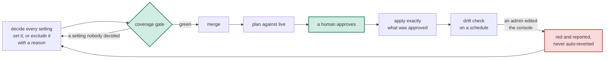

# Organizations as code

**A specification for managing the organizations everything else runs inside (the GitHub organization, the cloud organization, the identity provider, the SaaS admin consoles) as code.**

| | |
|---|---|
| Status | draft 1 |
| Applies to | every program that manages an organization; for any other infrastructure program, every requirement in §4, §5 and §8 is a SHOULD |
| Tools | any declarative infrastructure tool. Terraform and Pulumi appear only as examples of the two common styles |
| Conformance keywords | MUST, MUST NOT, SHOULD, SHOULD NOT, MAY, as in RFC 2119 |
| Reference implementation | private; this repository is one of the resources it governs (non-normative, Appendix A) |

## 1. The problem

Most infrastructure as code manages things the code created: a database, a
cluster, a bucket. A pipeline creates them, a staging copy rehearses each
change, and a mistake costs one application.

The organizations those things live in are different. Take a company's GitHub
organization, the example used throughout this spec. Someone created it by
hand years before any code. There is only one, with a couple of hundred
settings GitHub defaulted, and any admin can change them in the web console.

| Ordinary infrastructure assumes | An organization is | So this spec says |
|---|---|---|
| the defaults are fine | hundreds of vendor defaults nobody chose | decide every setting (§4) |
| the code is the only writer | edited by admins in a console | compare against live, not the tool's notes (§5) |
| the code created it | made by hand first | adopt what exists (§6) |
| a staging copy rehearses the change | a singleton | apply only the plan a human approved (§7) |
| its credential is ordinary | guarded by the most powerful credential you hold | keep that credential out of state and out of pull requests (§8) |
| the pipeline sits outside it | the host of its own pipeline | do not lock yourself out (§9) |

## 2. Terms

| Term | Meaning |
|---|---|
| **Organization** | an account that holds identity, access, policy or billing for other things: a GitHub organization, a cloud organization or account, an identity provider, a DNS account, an observability or SaaS workspace |
| **Program** | the code that manages one organization: a Terraform root module, a Pulumi project |
| **Provider** | the plug-in through which the tool talks to an organization's API |
| **Setting** | one field a provider lets you set on one resource type, such as a GitHub organization's `default_repository_permission` |
| **Schema** | the provider's own list of every resource type and setting it supports |
| **State** | the tool's notes on what it last saw and did: Terraform's state file, Pulumi's checkpoint. A cache, never the truth |
| **Live** | what the organization's API returns right now |
| **Plan** | the tool's list of what an apply would create, change or delete: `terraform plan`, `pulumi preview` |
| **Drift** | code and live disagree |
| **Live assertion** | a read-only check, run by the program, of a fact the organization reports but no setting controls; if the fact is wrong, the run fails |
| **Exclusion** | a setting the program deliberately leaves alone, written down with the reason |
| **Admin credential** | a credential that can change who administers the organization: its members, accounts or administrators |
| **Class** | `app`, `shared` or `foundation`: how far a mistake in a program reaches, which decides how it is applied (§7) |
| **Registry** | one list of every program and how each is applied and checked (§10) |

## 3. Principles

Where a requirement is silent, these decide.

1. **Live is the truth.** The tool's state is its notes, and notes go stale.
2. **Every setting is a decision.** A default nobody chose is an accident
   that no plan will ever show.
3. **The organization came first.** Code adopts it, and never owns whether it
   exists.
4. **There is no staging copy.** The plan is the only rehearsal, so the plan
   a human approved is the only thing that runs.
5. **What the tool records, every reader of its state can read.** A
   credential is never something it records.
6. **The organization hosts its own pipeline.** A change must never be able
   to block the fix for itself.

## 4. Decide every setting

**Every setting the provider offers is either set in code or excluded with a
reason, and a gate proves it.** A setting the code never mentions is
invisible: if an admin changes it, or the vendor changes its default, no plan
shows it.

*Example.* The code sets `default_repository_permission`, with a comment
saying why. It excludes `location` as "profile text, not policy".
A provider upgrade adds a new setting, and the gate fails until someone sets
it or excludes it.

1. Every setting the program manages MUST be set in code as a typed value.
   Its reason SHOULD sit beside it, where the next reader of the value sees
   it.
2. The program MUST keep a copy of the provider's schema, generated by a
   script and stamped with the provider version. The gate MUST fail when the
   provider version changes and the copy was not regenerated. Nobody edits
   the copy by hand.
3. For every resource type in scope, the gate MUST fail on any setting that
   is neither set in code nor excluded with a reason.
4. Every resource type in scope MUST be either managed or skipped as a whole.
   A skipped type MUST name a cause from the table below, and the code MUST
   NOT create it. A cause that says the API refused or a paid plan gates it
   SHOULD quote the API's response. The program keeps a list of the types it
   manages. The gate MUST fail if the code creates a type missing from that
   list, and if the list names a type the code never creates.
5. Coverage SHOULD span the provider's whole schema when it is small enough
   to audit. If a provider is too large to cover whole (a cloud provider can
   have thousands of types), the program MUST list the types it covers fully
   in a file the gate reads. That list SHOULD include every type controlling
   identity, access, audit or policy. Drift checks alone catch the rest. The
   coverage file SHOULD state what it does not prove, such as nested fields
   inside a setting.
6. A value the organization passes down by default (to new repositories, new
   accounts) SHOULD also be set on each one. Inheritance changes when the
   parent does, and no plan of the child shows it.
7. When a program first takes over an organization, a human SHOULD decide
   each setting one by one, from a recommended value, its reason and its
   risk. A separate read-only check SHOULD then verify the recommendations
   against how the provider really behaves.

| A type is skipped because | It can be revisited when |
|---|---|
| the API refuses the write | the program's identity is granted more |
| a paid plan gates it | the plan is bought |
| a provider defect | the provider ships a fix |
| it does not apply here | the reason it does not apply changes |
| it has no settable fields | never |

A skipped type is a decision to manage nothing, which leaves no diff to
review. The list is the only thing separating "reviewed and rejected" from
"never considered". A gate SHOULD pin how long the list is, so a new entry is
a visible change.

## 5. Compare against live

**Every plan, drift check and apply re-reads the real settings first.** The
tool's state is its notes from last time. An edit in the console does not
change the notes.

*Example.* An admin changes `default_repository_permission` in the web
console. The state still holds the old value. A plan that skips the re-read
says "no changes", and an apply reports success having done nothing. A plan
that re-reads shows the change, and the scheduled drift check goes red.

1. Every plan, drift check and apply MUST re-read live before it compares.
   Terraform's plan does this by default; Pulumi's needs `--refresh`.
2. The re-read MUST use the credentials and provider settings the code
   declares now. Some tools re-read with the ones saved in state, so a
   rotated key is never used, and an old valid key can read live as the
   wrong identity and miss drift.
3. Every applied program MUST be checked for drift on a schedule. Drift MUST
   turn the check red. A run that could not finish MUST say so, never pass.
   The check MUST NOT undo the drift itself, because the edit may be an
   emergency fix (§9.2).
4. Drift is fixed by changing code to match live, or by a reviewed apply that
   puts live back. State MUST NOT be edited by hand to hide drift. To fix
   drift, one hand edit is allowed: removing a resource that no longer exists
   and whose failed read blocks every job. It SHOULD follow the merge of the
   change that stops declaring the resource, because an apply in between
   recreates it.
5. Some facts can be read but not set: GitHub reports whether every member
   has two-factor authentication, but the provider offers no setting to
   require it. The program SHOULD check such facts with a live assertion
   that runs during the plan, the apply and the drift check. Each
   organization SHOULD prove its own baseline this way.
6. An instruction to ignore changes on a setting MUST carry its reason. It is
   not a control: the tool still reads the value, and only hides the
   difference. One that covers a field the vendor changes on its own SHOULD
   carry a date for a human to look again (§7.7).
7. The drift report SHOULD be one standing item that escalates rather than
   repeats, and SHOULD notify again only when the drift changes. Recording
   the commit last applied lets it tell "an apply is pending" from "live
   moved".
8. A change to identity or access settings made outside the pipeline SHOULD
   alert at once, not at the next scheduled check.

## 6. Adopt what already exists

**The organization was there before the code. Code takes over what exists,
and never recreates it.**

*Example.* Someone creates a repository in the web console. The next pull
request declares it with an import: a Terraform `import` block, or Pulumi's
`import` option. The plan shows the import and nothing else. From then on,
the drift check covers the repository.

1. A resource that already exists MUST be adopted into the program, never
   recreated. Its settings that only take effect at creation MUST be excluded
   with that reason. The adoption SHOULD be an import written in code, which
   does nothing once state holds the resource.
2. A resource created by hand MUST be declared and adopted by the next
   change. A test SHOULD pin the imported IDs.
3. The hand steps before a program's first apply MUST be written down before
   they run: creating the organization, the program's own identity and key,
   and the state storage and its encryption key. Anything created by hand at
   this stage SHOULD use exactly the settings the code declares.
4. An import never fails on a mismatch: it records whatever is there. So the
   first apply MUST follow a plan, read against live, with no delete, no
   replace, and no kind of change the written steps do not name.
   Anything else stops the apply. Until the first apply, state is
   disposable. The written list of what to import SHOULD be generated from
   the code and tested, so the two cannot disagree.
5. The first apply SHOULD go in stages, with settings that change who may
   merge or deploy applied last.
6. Code describes what should exist, so it cannot say that something must
   not. A vendor default nobody wants (a default network, a sample project)
   SHOULD be removed once by a reviewed script that reads live, then kept out
   by a live assertion (§5.5).
7. Drift cannot see what code never declared. A census SHOULD list the live
   members of every collection that grants access (members, administrators,
   installed apps, accounts, repositories) and report each one the code does
   not declare.

## 7. Apply only what a human approved

**There is no staging copy of an organization, so the plan is the only
rehearsal. A human reads it, and the apply runs nothing else.**

*Example.* A pull request changes a branch ruleset and merges. Someone starts
the apply job from `main`. The job plans against live and pauses. An approver
reads the plan and approves. Before applying, the job checks that its list of
resources and actions matches the approved plan, and stops if it does not.

| Class | What belongs in it | How it is applied |
|---|---|---|
| `app` | what one application owns | with that application's deploy |
| `shared` | what several applications share, recoverable, with a real second copy to rehearse in | automatically to the rehearsal copy; to production after approval |
| `foundation` | anything that needs an admin credential; anything organization-wide that controls trust, identity or audit; anything that cannot be undone | only as in item 3 |

1. Every program MUST have one class. When two fit, the credential the apply
   needs decides: a program that needs an admin credential is `foundation`.
   The class belongs to the program, never to an environment.
2. An organization program is `foundation` unless a real second copy exists
   to rehearse it in. Even then, §8.4 holds: a job that applies
   automatically never holds the admin credential.
3. A `foundation` program:
   - MUST NOT apply on merge. It applies only when someone starts it from the
     default branch.
   - MUST plan in that job, against live, and pause for a human to approve.
     The forge or the pipeline MUST enforce the pause, and an admin MUST NOT
     be able to skip it.
   - MUST apply from the commit that produced the approved plan. A gate MUST
     refuse an apply whose resources or actions differ from that plan.
     Applying the saved plan file itself is stricter, and SHOULD be used
     where the tool supports it.
   - MUST NOT plan from unmerged code (a pull request's, or any branch's),
     because the plan runs with the admin credential.
   - SHOULD check the plan against actions no approval allows (closing an
     account, turning off audit logs). That check MUST fail when it cannot
     read the plan.
4. A `shared` or `app` program SHOULD show its plan, read against live, on
   every pull request that touches it.
5. A resource whose deletion cannot be undone (an account, a repository, a
   membership) MUST be guarded against deletion by plan: by archive on
   delete, deletion protection, or the tool's protect flag. Removing a
   resource from code plans its delete, so state SHOULD be checked for what
   the plan will delete before the code is removed. Renaming a resource in
   code plans a delete and a create, so a test SHOULD pin every resource's
   name.
6. Where an organization exists once per environment, each SHOULD get the
   same jobs, gates and checks. A check that exists in one and not the other
   is a gap the cheaper one hides.
7. A setting held below its intended value for a reason SHOULD carry the
   trigger to revisit it. A date trigger SHOULD fail the build on its date,
   so a temporary concession cannot become permanent by being forgotten.

## 8. Keep the admin credential out of state and out of pull requests

**Whatever the tool records, every reader of its state can read. So a
credential is never something the tool records, and code nobody has approved
never reaches the admin credential.**

*Example.* A provider takes its API key as a configuration field. Some tools
save that field in state, and then anyone who can read and decrypt state
has the key.
Passing the key through the job's environment instead keeps it out of state
entirely.

1. A credential MUST NOT be passed as a resource setting, or as a provider
   field the provider marks secret. A setting whose value is itself a secret
   MUST be declared write-only, and that declaration applied before the
   first real value is written. A credential nothing needs to read back
   SHOULD be created outside the program, straight into the secrets store. A
   resource that would put a secret in state SHOULD be referenced by ID
   rather than managed, with its settings checked by a live assertion.
2. Where a provider makes item 1 impossible, the exception MUST be written
   out beside the code, MUST be held by a test that fails if it widens, and
   the credential MUST be treated as leaked when it rotates.
3. Item 1 MUST be enforced three ways, because each misses what the others
   catch: a scan of the code, using the provider's own list of secret fields;
   a check that every program runs that scan; and a scan of what state
   actually holds, which reports field paths, never values.
4. Credentials are kept apart by job:
   - A job that applies automatically MUST NOT hold an admin credential.
   - A job that plans a pull request holds the weakest credential of all.
   - Unmerged code (a pull request's, or any branch's) MUST NOT reach an
     admin credential without the human approval of §7.
   - Do not assume an approval environment limits which branch can run.
     Unless that is proven, the credential's trust condition (for example,
     the subject of an OIDC token) SHOULD name the default branch, and every
     job that uses the credential SHOULD refuse to run for a pull request.
   - A job MUST NOT be able to create a credential stronger than one it may
     hold.
   - The drift check SHOULD use a read-only credential.
5. A job that plans pull requests runs code nobody has reviewed yet. It MUST
   be able to read only the state of the programs registered for it to plan,
   including any registered ahead of their first plan. A test MUST check that
   access both ways: missing access is loud and harmless, extra access is
   silent and is the leak. Encryption does not help when the reader holds the
   key. Every other job SHOULD read only its own program's state.
6. The admin credential SHOULD be an identity the organization owns rather
   than a person's token, read at run time by a role that can read nothing
   else. A credential SHOULD exist once per consumer, environment and
   organization, named for its consumer. A rotation SHOULD verify the
   new key by fingerprint, never by printing it, and retire the old one only
   once it has gone quiet.

## 9. Do not lock yourself out

**The organization hosts the repository and pipeline that manage it, so a
bad change can block its own fix. Know the traps, and keep a way back that
does not need the pipeline.**

*Example.* A ruleset makes a new status check required before anything has
ever reported it. Every pull request now waits forever, including the one
that would undo the ruleset.

| Trap | Why it locks you out |
|---|---|
| requiring a check that has never reported | every change waits on a result that never comes |
| requiring an approval nobody can give | one maintainer cannot approve their own change |
| a rule that blocks the program's own identity | the next apply cannot undo the rule |
| the program manages the approval its own apply waits on | a bad plan can remove the person who would have stopped it |
| a deny policy that also binds the recovery identity | the way back is closed by the change it was meant to undo |
| a key policy that drops the account's own recovery access | state, and everything the key encrypts, becomes unreadable |

1. A program MUST NOT apply a change that could block its own apply job, or
   merges into its own repository, without a reviewed way back. A gate SHOULD
   check that every required status check has something that reports it on
   every path to the default branch, a merge queue included. A deny rule
   SHOULD be applied only after the way back is tested live, first to one
   part of the organization, and then widened.
2. A break-glass path MUST exist that does not depend on the program: an
   identity and written steps that can switch off the bad control directly.
   It MUST NOT depend on an identity provider the program manages. It SHOULD
   need a hardware second factor, SHOULD be protected from deletion by plan,
   SHOULD alert on every use, and SHOULD be drilled on a schedule, each drill
   announced in advance so it is recorded rather than paged. Afterwards
   the next reviewed apply puts code back in charge, and the drift check
   shows the gap until it does.
3. A program MUST keep a written list of what it deliberately does not
   manage, each with its reason. An item that matters for security but that
   the program cannot reach SHOULD have a read-only check instead.

| A program does not manage | Because | Example |
|---|---|---|
| content that changes in normal work | a diff of it carries no signal | issues, labels, releases, pull requests |
| what a person owns | it belongs to them, not the organization | a user's keys, accepting an invitation |
| what its identity cannot reach | the API serves it only to a person's token | which repositories a third-party app may see |
| a second place deciding the same policy | the organization-wide setting stops being the answer | a per-repository override of an organization policy |

## 10. The registry

**One list of every program, so that no program can skip the gates.**

1. An implementation MUST keep one registry of every program. Each entry
   MUST state the program's class, environments, credentials and drift
   contract (which environments are checked against live, and which live
   assertions run), each set explicitly, so no omission decides by default.
   The providers a program uses MAY be derived from its declared
   dependencies.
2. The gate MUST fail a program that is not registered, a registered program
   without a coverage gate for each provider it uses (§4), and an applied
   program without a scheduled drift check (§5.3).
3. The plan, drift, apply and scan jobs, and each program's access to state,
   SHOULD be generated from the registry, so registering a program enrolls it
   everywhere.
4. The registry SHOULD also list every organization the company holds that no
   program manages, with the reason. A list that starts from the programs
   cannot show what has none.

## 11. Enforcement

A conforming implementation MUST reject each of the following.

| Rule | The gate rejects |
|---|---|
| Decide every setting (§4) | a schema copy older than the provider; a setting neither set nor excluded; a type neither managed nor skipped; a skipped type with no cause, or created by the code; a type created but missing from the managed list, or listed but never created |
| Compare against live (§5) | a plan, drift check or apply that does not re-read live with the code's credentials; drift, on the schedule; an unfinished run reported as passing |
| Apply only what was approved (§7) | a `foundation` apply on merge, or not started from the default branch; an apply whose commit, resources or actions differ from the approved plan; a plan check that cannot read the plan |
| Credentials (§8) | a credential in a setting or a secret provider field; an exception that widened; a program that skips the scan; a pull request plan job that can read state it is not registered to plan |
| Registry (§10) | an unregistered program; a registered program without a coverage gate per provider; an applied program without a drift check |

A gate MUST assert only what the code and the organization's API report.
Every failure message SHOULD name the fix.

## 12. Conformance levels

| Level | Name | Requires | In short |
|---|---|---|---|
| 1 | **Declared** | §4.1, §6.1 to §6.4, §7.1, §7.2, §10.1 | every organization a program manages is registered, adopted rather than created, and applied only by its pipeline |
| 2 | **Proven** | Level 1, plus §4.2 to §4.5, §5.1 to §5.4, §7.3, §8.1 to §8.5, §10.2 | every setting is decided, every check reads live, a `foundation` apply runs only what was approved, and no credential sits in state or within reach of a pull request |
| 3 | **Sealed** | Level 2, plus §5.5 to §5.8, §6.6, §6.7, §7.5 to §7.7, §9, §10.4 | every organization is accounted for, every member is in code, every baseline is proven live, deletion is guarded, and there is a tested way back |

A level requires every MUST in the items it lists. Where a listed item holds
only SHOULDs, the level makes them requirements. An implementation claiming a
level SHOULD say so beside its registry, and name there any requirement of
the next level it does not yet meet.

## 13. Operational considerations

| Situation | What to do |
|---|---|
| A paid plan changes | Every setting skipped or excluded because of the plan is a decision again. Changing plans does not apply the new plan's defaults by itself |
| Moving a resource to another program | Move it in state, and review the move like an apply. Never delete it in one program and create it in the other: for a singleton, that delete is the outage |
| A person leaves | Removing them from code removes them from the organization. A provider option that downgrades instead of removing keeps access that no line of code explains, and SHOULD be off |

## Appendix A (non-normative): the reference implementation

The reference implementation is a private repository. It manages each of its
organizations as a registered program, most at the `foundation` class. An
organization with a full second copy to rehearse in is applied as `shared`.

| Part | Implements |
|---|---|
| the registry, with each program's class, environments, credentials and drift contract, and a test enrolling every program | §10 |
| per provider: a schema regeneration script, the versioned schema copy, and a coverage file listing set settings, exclusions with reasons, skipped types with causes, and the scope | §4 |
| a scheduled drift job that re-reads live with the code's credentials and keeps one standing report | §5 |
| live assertions run in plan, apply and drift | §5.5 |
| runbooks for bootstrap, adding a resource created by hand, and break-glass | §6, §9 |
| a `foundation` apply job started by hand, paused for a required approval, checked against forbidden actions, and refused if its resources and actions differ from the approved plan | §7 |
| a secret-field scan of the code, a check that every program runs it, a scan of state, and a test of the pull request plan job's state access both ways | §8 |

This repository is one of the resources it governs. An organization owner
created the repository by hand, and the next change declared it and imported
it (§6.2). Its settings, its rulesets and the required workflow of the
[append-only-adr](../append-only-adr/SPEC.md) spec's reference implementation
are declared there, and the drift check reports a console edit to any of
them. Anyone can read the live result from GitHub's public API:
`GET /repos/perimetercompute/specs/rules/branches/main`.

The implementation claims Level 2. It does not meet Level 3, and does not
publish which requirements it misses: a public list of where an
organization's controls are incomplete is a map for an attacker.

## Appendix B (non-normative): one deployment

One company, agents writing most of the code, its GitHub organization under
a program since 2026-07-23. Counts as of 2026-10-16.

| | |
|---|---|
| Programs at the `foundation` class | 7 |
| Decision records that set part of this mechanism, classified by reading each one | 51 |
| Of those, later superseded in whole or in part | 18 |
| Resource types in the GitHub provider's schema | 88 |
| Of those, skipped as a whole, each with a cause | 71 |

## Appendix C (non-normative): relation to existing practice

| | Infrastructure as code, as usually run | A settings-sync app | A posture scanner | This specification |
|---|---|---|---|---|
| What it covers | the settings someone thought to write | the settings its file format names | the benchmark's checks | every setting in the provider's schema, set or excluded with a reason |
| Drift | against state, when a plan happens to run | reverted on the next event | reported against the benchmark, not against code | against live, on a schedule, reported and never auto-reverted |
| Who creates the organization | often the code | a human | a human | a human; the code adopts it |
| Review of a change | the plan, if someone reads it | the file change | none | a plan read against live, approved by a human, and applied exactly |
| The admin credential | often in the pipeline's environment, sometimes in state | held by the app | read-only | never in state, and out of reach of a pull request without approval |

None of those is wrong for what it was built to do. The difference is the
organization: a singleton that existed before the code, edited in a console,
hosting the pipeline that manages it, guarded by the most powerful credential
the company holds.
