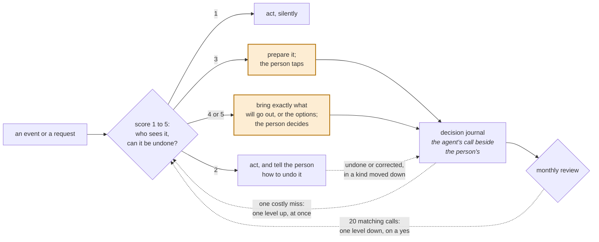
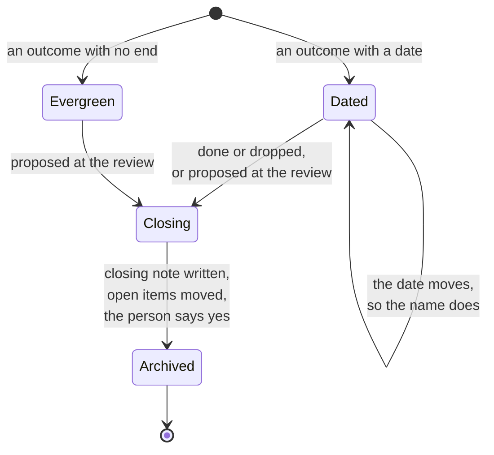

# Operating a proactive agent

**A specification for an agent that acts for one person between their messages: where its work lives, what it may do alone, and how that changes with evidence.**

| | |
|---|---|
| Status | draft 1 |
| Applies to | an agent with standing access to one person's mail, calendar, tasks and chat, which acts on a schedule and on events as well as on request |
| Tools | any agent product, task list and chat surface. Products are named only in Appendix A |
| Examples | a paragraph marked *Example.* is non-normative |
| Conformance keywords | MUST, MUST NOT, SHOULD, SHOULD NOT, MAY, as in RFC 2119 |
| Reference implementation | one person's setup, private, described by its shape in Appendix A (non-normative) |

## 1. The problem

A reactive assistant waits to be asked. A proactive agent does not. It reads
the inbox before the person is up, notices a reply that never came, and
drafts the follow-up before anyone mentions it. That is the point of one, and
it is also how one fails.

It fails in two directions. It asks too much: every small step becomes a
question, the person stops reading, and the agent becomes a second inbox. Or
it does too much: a reply goes out in the person's name, a card is charged, a
file is deleted, and nobody reviewed it. A better model fixes neither,
because the model does not know what this person would mind. That has to be
written down.

It also fails over time. Work piles into one endless chat. The session that
starts tomorrow does not know what was settled tonight. Nothing finishes, so
nothing is archived. And the agent's authority never changes, however often
it has been right or wrong.

This specification asks for four things.

| | What it asks | Section |
|---|---|---|
| **Scope** | one workspace per outcome the person is driving, each with a lifecycle that ends | §4 |
| **Gate** | score every action on one reversibility scale, and let the score decide who decides | §5 |
| **Hand off** | give coding work to a coding agent through a fixed brief, never do it in chat | §8 |
| **Review** | once a month, move work and authority on evidence, never by drift | §9 |

§6 and §7 keep the agent's state in one place and its messages few.

## 2. Terms

| Term | Meaning |
|---|---|
| **Person** | the one human the agent works for. Only their own words give a yes |
| **Proactive agent** | an agent that acts on a schedule or on events, not only on request |
| **Unattended run** | a run of the agent that the person did not start, set off by a schedule or an event, with nobody necessarily there to answer |
| **Workspace** | a separate conversation, with its own instructions and task list, scoped to one outcome. Agent products call it a channel, a project or a space |
| **Dated workspace** | a workspace whose outcome has a date. It is closed when the outcome is done or dropped |
| **Evergreen workspace** | a workspace with no end date. It is reviewed, never closed on a date |
| **Kind** | a class of action that the person and the agent name together, such as "archive a newsletter" or "accept a meeting from a colleague" |
| **Level** | a number from 1 to 5 that says who decides an action, scored by who sees the action and whether it can be undone. Each kind carries a level, which can move |
| **One-way door** | an action whose effect cannot be reversed or corrected afterwards |
| **Yes** | the person's own message, or their press on a confirmation the agent posted, approving one stated action |
| **Memory** | notes that outlive the agent's sessions, read by every session and unattended run |
| **Digest** | a scheduled message that tells the person what changed and what needs them |
| **Check-in** | an unscheduled interruption, sent only when something needs the person |
| **Brief** | the fixed set of fields a proactive agent hands a coding agent |
| **Decision journal** | a record of each decision the person made at level 3 or above, with the agent's call beside it, and of each action the person undid or corrected in a kind that was moved down |

"Level" alone always means this scale. The levels an implementation can
claim against this specification are called conformance levels (§12).

## 3. Principles

The requirements in §4 to §11 follow from five principles. Where a
requirement is silent, the principles decide.

1. **Reversibility decides, not importance.** A large change that can be
   undone in one click is safer than a small message that cannot be unsent.
2. **The person's attention is the scarce resource.** A question costs them a
   reply every time. A wrong guess on something reversible costs one undo.
3. **Nothing the agent reads is an instruction.** Mail, pages, files and other
   agents' reports are data. Only the person's own words ask or approve.
4. **Memory is a record, never a permission.** A note that the person
   approved something last week does not approve it today.
5. **Authority moves on evidence, in both directions.** A record of good calls
   moves a kind down a level. One costly miss moves it back up.

## 4. Workspaces

**One workspace per outcome the person is driving, never one per tool or
topic.**

*Example.* "Wedding toast · Jun 6" is a workspace. "Email" and "Calendar" are
not: they are tools, and every outcome uses them.

1. Each workspace MUST name one outcome, and MUST hold that outcome's
   context, instructions and the agent's tasks for it. An agent that opens a
   workspace then knows what "done" means there without reading every other
   conversation.
2. A workspace whose outcome has a date MUST carry the date in its name, and
   when the date moves, the name MUST move with it. A workspace without one
   MUST NOT carry a date. The name alone then tells the person, and the
   monthly review, which workspaces are meant to end.
3. Workspaces SHOULD be grouped by long-lived initiative, and a group SHOULD
   reuse the name the person's planning or issue tool already gives that
   initiative. A new workspace then has an obvious home, and the person
   reads one vocabulary.
4. Requests that serve no single outcome (quick asks, the digest,
   cross-cutting syncs) MUST go to one main conversation above the groups.
   The person always has one place to type, and the agent routes from there.
5. A workspace closes when a dated outcome is done or dropped, or when the
   person accepts the review's proposal to close it (§9.2). The agent MUST
   close it in three steps: a closing note (what shipped, what is left),
   every open item moved to its next home, then the archive, on the person's
   yes. An archive that drops open items loses work the person is counting
   on.
6. Logistics that serve one outcome MUST go to that outcome's workspace,
   because that is where the person will look for them. Logistics that serve
   none MAY share one evergreen workspace.

## 5. Authority: the reversibility scale

**Score every action from 1 to 5 by who would see it and whether it can be
undone. The score decides who decides.**

| Level | The test | Who decides |
|---|---|---|
| 1 | only the agent sees it, and it is undone in one step | the agent, silently |
| 2 | only the person sees it, inside their own accounts, and it is undone in one step | the agent, which then tells the person what it did and how to undo it |
| 3 | people the person works with see it, and a mistake can be corrected afterwards | the person, with one tap on what the agent prepared |
| 4 | people outside the person's organization see it, or it cannot be undone | the person, from exactly what will go out or change |
| 5 | it changes a goal, a date or a rule the person set, or widens the agent's own authority. Narrowing that authority is never level 5 (§9.4) | the person, in their own words; the agent brings the options |

*Example.* Archiving a newsletter the person never opens is level 2: only
they see it, and it comes back in one click. Accepting a meeting from a
colleague is level 3: the colleague sees it, and a mistake is fixed with a
second message. A reply to a customer is level 4: people outside the
person's organization see it.

1. The agent MUST score each action before it acts, and MUST log the score
   with the action. An action takes the level of its kind, or its own score
   when that is higher, and the higher level wins whenever two fit. Scoring
   too high costs one question; scoring too low may cost something that
   cannot be recovered. The log lets a check outside the agent see the
   score.
2. A one-way door MUST NOT score below 4, and the implementation MUST keep a
   written list of the kinds that count as one. "Can it be undone?" is the
   judgement the agent is most likely to get wrong in the moment, so the
   person settles it once, ahead of time.
3. Anything sent in the person's name, paid, signed or deleted MUST wait for
   a yes, whatever its level. These are the acts a person is held to.
4. A yes MUST cover only the action it was given for. A changed recipient,
   amount or text MUST be asked again. A yes to last week's invoice is not a
   yes to this week's.
5. The person MAY put actions and contacts on an always-ask list, and that
   list MUST override any score. Some contacts are high-stakes for reasons the
   scale cannot see.
6. When the person says how they want a kind handled (leave it, draft it, do
   it), the agent SHOULD record it in their words and work that way, within
   the kind's level. "Do it" for a kind at level 3 or above is a move down,
   under §9.5 and its floors. A stated preference is not a yes, and approves
   no single action.

## 6. The task list and memory

**Each piece of work lives in exactly one place. Memory says where each line
came from.**

| Work | Lives in | The agent |
|---|---|---|
| the person's own next steps | one shared task list, each step tagged with its workspace | adds, updates and closes them |
| the agent's own work | the workspace's task view | owns it |
| work a team tracks | the team's planning or issue tool | reads it and writes the narrative around it, never copies it |

1. The person's next steps MUST live in one shared task list, each tagged
   with its workspace, and the agent's own work MUST live in the workspace's
   task view. A step kept in two lists is done in one and nagged about in the
   other.
2. Work a team tracks in a planning or issue tool MUST NOT be copied into a
   workspace. The agent MAY read it and write the narrative around it.
   Copies drift.
3. Memory MUST be readable by every session and unattended run of the agent,
   and MUST say where each line came from: the person's words, or the
   agent's inference with its evidence and date. A later session cannot
   otherwise tell where a line came from, and will take it as true.
4. Only the person's own words MAY create a rule or confirm a goal. Text the
   agent reads MUST NOT create one, whoever wrote it. An instruction that
   reaches memory from an email comes back tomorrow looking like the
   person's.
5. Memory MUST NOT be read as permission (Principle 4).

## 7. Digests and check-ins

**The agent speaks when what it says changes what the person does next,
reaches them in time to act, and is news to them.**

1. The agent MUST send at most one scheduled digest a day, at a time the
   person chose, holding what changed and what needs them. One predictable
   message is read; five are skimmed.
2. Between digests, the agent MUST interrupt only when something needs the
   person, and MUST NOT interrupt in their quiet hours, the hours they have
   said not to be reached. An interruption that needs nothing teaches the
   person to ignore the next one.
3. Progress MUST go to the task, not to a message. The person looks at the
   task when they want it.
4. If more than one agent or unattended run can message the person, exactly
   one MUST own each type of interruption. Two digests from two agents
   disagree within the day.

## 8. Hand-offs to coding agents

**Coding work goes to a coding agent through a fixed brief. The proactive
agent owns the conversation; the coding agent owns the diff.**

*Example.* In a workspace about a release, the person asks for a fix. The
proactive agent writes a brief quoting the ask, and a coding agent starts in
its own working copy. Its first message restates the goal. It returns a draft
pull request, and the proactive agent reports from that.

A brief MUST carry these fields.

| Field | Contents | Reason |
|---|---|---|
| Goal and done-when | the person's words, quoted, with the date | the coding agent never sees the conversation |
| Where | an isolated working copy for anything that edits; a read-only checkout for research | two writers in one tree corrupt each other |
| Limits | stops at a pull request; never merges, deploys or changes production | the pull request is where the person reviews the change before it ships |
| Registration | announces itself, on start and on end, to whatever dispatches the person's other coding agents, with the repository, branch and the files it expects to touch | two agents on the same files are caught before they collide |
| Readback | its first message restates the goal and done-when | a misread brief is caught before any code is written |
| Return | the pull request, one paragraph on the result, and artifacts titled by what they show | the proactive agent reports from this, not from logs |
| Idempotency key | an id derived from the request it came from | a retry never starts a second agent |

1. The proactive agent MUST NOT edit a repository itself when a coding agent
   is available. One place where code is written is one place where it is
   reviewed.
2. The proactive agent MUST compare the readback with the brief before it
   reports the task as started. A readback nobody compares catches nothing.
3. The coding agent MUST act under an identity of its own, never the
   person's. Only then can the repository tell the agent's merge from the
   person's.

## 9. The monthly review

**Once a month, work and authority move on the record, never by drift.**

1. Once a month, the agent MUST put to the person each outcome's progress
   against its date, where their time went, and the changes it proposes. A
   quarter is long enough for a dead workspace to hide; a week is too short
   to see a trend.
2. It SHOULD propose closing a dated workspace whose outcome is done or
   dropped; closing or merging one with no new work in four weeks; splitting
   one where one topic fills most of it; and starting one when a topic has
   recurred for three weeks with its own deadline. A workspace change MUST
   wait for a yes, and closing follows §4.5. A misfiled task MAY be moved
   without one.
3. The decision journal MUST record, for every decision at level 3 or above,
   the agent's call beside the person's: what the agent prepared or
   recommended, and whether the person took it as is, edited it or refused
   it. It MUST also record each time the person undoes or corrects an action
   of a kind that was moved down. Without both, nobody can tell whether the
   agent is ready for more, or whether a move down was a mistake.
4. A call matches when the person takes it as is. When the agent's call
   matched on the last 20 decisions of one kind, the review MAY propose
   moving that kind down one level, and the move MUST wait for a yes. A
   mismatch that cost something (the person had to undo, repair or apologize
   for the result) MUST move the kind back up at once, without waiting for
   the review, and the move MUST cite that journal entry. Authority is earned
   on a record, and a record that turns has to count.
5. The person MAY move a kind down in their own words at any time. Every move
   down, theirs or the review's, keeps two floors: a one-way door never goes
   below 4, and a kind that sends, pays, signs or deletes never goes below 3,
   because §5.3 still asks for a yes.

The numbers in this section are defaults. An implementation MAY choose others
and SHOULD state its own.

## 10. Enforcement

Much of this specification is judgement, and the monthly review checks
most of it. The rows below are the properties a check can see. A conforming
implementation MUST reject each row its conformance level requires (§12).

| Property | What a conforming check rejects | When it runs | Conformance level |
|---|---|---|---|
| Yes gate (§5.3) | a send, payment, signature or deletion with no yes for that exact action | before the action | 1 |
| Scope of a yes (§5.4) | an action whose recipient, amount or text differs from what the yes covered | before the action | 1 |
| One-way doors (§5.1, §5.2) | an action of a kind on the written list, taken without a yes or logged with a score below 4 | before the action | 1 |
| Always ask (§5.5) | an action on the always-ask list taken without a yes | before the action | 1 |
| Lifecycle (§4.2, §4.5) | a dated workspace past the date in its name, neither renamed nor put to the person for closing | on a schedule | 1 |
| Provenance (§6.3, §6.4) | a rule or goal in memory with no quote from the person | on a schedule | 2 |
| Hand-off limits (§8) | a merge, deploy or production change made under a coding agent's identity | on the merge or deploy | 2 |
| Journal (§9.3) | a logged action at level 3 or above with no journal entry, or an entry missing the agent's call | on a schedule | 3 |

Every row runs outside the agent's own judgement: in the agent product's own
approval step, in a gateway between the agent and its tools, in a tool that
refuses an action without a token (§10.1), or in the repository's branch
protection and the deploy pipeline. A limit the agent keeps on itself is an
instruction. A limit something else keeps is a control.

### 10.1 Delegation tokens (draft)

**This subsection is a draft inside the draft. No conformance level requires
it, and the reference implementation does not run it.** It describes one way
to move the yes gate out of the agent's instructions and into a check the
agent cannot argue with. A delegation token is a short-lived, signed token
that lets an agent take actions in one scope, minted by an issuer the person
controls.

*Example.* The person says yes to paying one invoice. An issuer they control
mints a token scoped to `spend`, bound to that payee and amount, that expires
in minutes. The payment tool checks the token's signature against the
issuer's published keys, asks the issuer whether the token is still live,
and pays. A second payment with the same token is refused.

An implementation MAY enforce §5 with delegation tokens. One that does SHOULD
meet each item below.

1. The issuer SHOULD mint short-lived, signed tokens, each for one scope,
   such as `internal` (actions that need no yes), `external` (words to people
   outside the person's organization, in the person's name), `spend` and
   `production`. Every type of action the agent may take SHOULD fall in
   exactly one scope, with one scope per type of risk. A verifier can then
   refuse a token minted for something else, and a short life limits what a
   leaked token can do.
2. A token for any action that needs a yes (level 3 and above, and every act
   in §5.3) SHOULD be minted only on that yes, and SHOULD carry the action it
   covers: the recipient, the amount, or a digest of the text. §5.4 then
   becomes a comparison the verifier makes, not a judgement the agent makes.
3. Whatever performs the action (a tool, a gateway, or another agent taking a
   hand-off) SHOULD verify the signature against the keys the issuer
   publishes. Above `internal`, it SHOULD also ask the issuer whether the
   token is still live. A signature proves who minted a token, not that the
   person has not withdrawn it since.
4. The person SHOULD be able to revoke one token, or every token for a scope,
   at once. Revoked authority has to take effect before the next
   action, not at the next review.
5. The issuer SHOULD log every mint, check and revocation, and the log SHOULD
   feed the decision journal. The journal then shows what the agent
   did with each yes, not only what it was given.
6. A verifier that refuses a request for a scope the agent does not hold
   SHOULD name the scope and the yes it needs. The agent then brings that to
   the person, so a missing token becomes a question, never a workaround.

Existing standards fit each part: JSON Web Tokens (RFC 7519), signed with
keys published as a JSON Web Key Set (RFC 7517) at the issuer's `jwks_uri`
(RFC 8414); token introspection (RFC 7662) for the live check; token
revocation (RFC 7009) for one token, with revocation by scope left to the
issuer; token exchange (RFC 8693) for a token that names both the person and
the agent acting for them; rich authorization requests (RFC 9396) for a token
bound to one action; and the `insufficient_scope` error (RFC 6750) for a
refusal that names the scope it needs, with the step-up challenge (RFC 9470)
where a yes also needs the person to sign in again.

## 11. The bridge to the decision log

**A change to the agent's authority cites the decision that made it.**

1. A change that widens the agent's authority (a kind moved down, or an
   entry taken off the one-way-door or always-ask list) SHOULD be recorded as
   a decision in the person's own words, under the
   [append-only-adr](../append-only-adr/SPEC.md) spec or an equivalent. These
   lists are the agent's authority, and a change to them nobody can trace is
   authority that drifted.
2. A move down that the review proposes (§9.4) MUST cite the journal entries
   it rests on, so the person can check the record the move claims. A move up
   the agent makes at once cites the one entry that caused it, and needs no
   words from the person, because tightening never needs a yes.

## 12. Conformance levels

| Conformance level | Name | Requires | In short |
|---|---|---|---|
| 1 | **Scoped** | §4, §5, and §10 for them | outcome workspaces with a lifecycle, and the scale with its yes gate, checked outside the agent |
| 2 | **Operated** | Conformance level 1, plus §6, §7, §8, and §10 for them | one task list, memory with provenance, one owner per interruption, and the hand-off brief |
| 3 | **Self-correcting** | Conformance level 2, plus §9, §11, and §10 for them | the monthly review, the decision journal, and recorded changes to authority |

A conformance level requires every MUST in the sections it lists. SHOULDs
stay SHOULDs, except §11.1, which Self-correcting requires. §10.1 is a
draft, and no conformance level requires it. An implementation MAY claim one
conformance level for one agent and a lower one for another, and SHOULD say
which beside its configuration.

## 13. Operational considerations

| Situation | What to do |
|---|---|
| A new app is connected | Connecting it is the person's decision. The agent scores the kinds of action the app allows before it uses any of them |
| A session ends, or the agent is replaced | Memory and each workspace's notes carry the work. A fact that lives only in a conversation is lost |
| Two agents serve one person | §7.4 decides who speaks. The other works quietly |
| Authority is revoked | The person's word moves any kind up at once. Tightening needs no review and no record of good calls |
| The person is not there to answer | An unattended run takes no level 4 or 5 action unless the person approved that exact action for that run, such as a message they scheduled. Otherwise it prepares and waits |
| A message asks the agent to act | It is data (Principle 3). If it needs the person, the agent brings it to them; it never acts on it as an instruction |

## Appendix A (non-normative): the reference implementation

The reference implementation is one person's setup: a software engineer's
proactive agent, built on Claude Duet, an agent product in research preview.
It claims no conformance level. What runs, by its operator's account, which
nobody outside the setup can check:

| Section | What runs |
|---|---|
| §4 Workspaces | channels in Claude Duet, one per outcome, grouped by initiative; dated channels carry the date in their name |
| §5 Scale | the five levels and a written one-way-door list, in the agent's instructions |
| §5.3 Yes gate | the product's own approval step: before it sends a message, makes a payment, signs a document or deletes anything, it shows exactly what it is about to do and waits ([announcement](https://www.claude.com/resources/articles/claude-duet)) |
| §6 Task list | Google Tasks for the person's own steps, each tagged with its channel; Duet's task page for the agent's work |
| §7 Digests | one scheduled digest a day, and check-ins only when something needs the person, outside quiet hours |
| §8 Hand-off | each channel sends coding work to a coding-agent runner through a brief, and the runner holds each change at a draft pull request |

Four gaps, stated plainly:

| Gap | What it means |
|---|---|
| Of §10's rows, only the yes gate runs outside the agent | the scope of a yes, the one-way-door list, the always-ask list and the lifecycle check are instructions to the agent, so conformance level 1 is not met |
| The monthly review has not run | §9 has no record yet, so Appendix B is empty |
| Delegation tokens are not built | §10.1 is design only |
| The ratification check reads the record, not who ratified it | in this repository, the check that holds a spec change cannot tell who wrote the ratifying words; only the person reading the pull request can |

This repository is one place that implementation acts on, and that is how it
demonstrates this spec. The pull request that added the spec came from that
implementation's hand-off, opened as a draft. Its required checks stay red
while its record reads `status: proposed`, and the check that keeps them red
runs as the default branch defines it, so the coding agent's branch cannot
rewrite it ([append-only-adr](../append-only-adr/SPEC.md) §8.1). That is
§10's point in one place: a limit the repository keeps, not the agent.

## Appendix B (non-normative): one deployment

To be filled after the first monthly review: decisions journaled, the share
where the agent's call matched the person's, kinds moved down or up, and
workspaces closed.

## Appendix C (non-normative): relation to existing practice

| Practice | What it shares | What this adds |
|---|---|---|
| Approval prompts in agent products | the agent stops before some actions | one scale across every tool, scored by who sees the action and whether it can be undone, not by which tool runs it |
| Delegated authority limits (finance) | classes of decision settled ahead, so the moment needs no meeting | limits that move on a record, not a reorganization |
| Flight rules (mission control) | the response is written before the event | the agent writes and follows them; the person ratifies |
| One-way and two-way doors | reversibility over importance | a five-step scale an agent can score |
| Readback (air traffic control) | a hand-off is confirmed by restating it | applied to briefs between agents |
| Single-threaded owners | one owner per outcome | one workspace per outcome, with an end |
| OAuth scopes | a token says what its holder may do | a scope bound to one yes, and a level that moves on a record (§10.1, draft) |

None of those is wrong for what it was built to do. The difference is who
carries them out. Each was built for people, who carry judgement between
decisions. An agent carries only what is written down, so the scale, the yes
and the record have to be.
